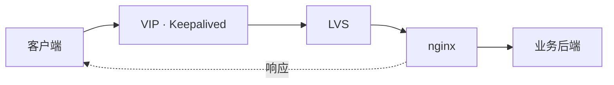

# RocketLB

机房高可用负载均衡的控制面。数据面是 nginx 和 keepalived，控制面保存期望状态，渲染配置，再通过 SSH 安装、校验和发布。

## 数据面架构

客户端只访问 VIP。包按下面这条线走，响应从 nginx 直接回到客户端，不再经过 LVS。



LVS 不改目标 IP，只把二层网卡地址改成选中的 nginx。nginx 的回环上有一份 VIP/32，所以认这个地址。

| 层 | 谁在做 | 挂了以后 |
| --- | --- | --- |
| 入口 | Keepalived | 检查本机 LVS。LVS 不可用，或这台机器停了，VIP 交给另一台转发机器 |
| 分发 | 拿到 VIP 的那台上的 LVS | 按端口轮询。nginx 端口连不上，只把这台 nginx 从名单拿掉，VIP 不动 |
| 代理 | nginx | 七层走 HTTP，四层走 TCP 或 UDP。业务后端挂了，靠 nginx 自己的被动检查 |

### 两台一起

每台机器都有入口、分发、代理。优先级高的那台拿着 VIP，并把连接分给两台 nginx，包括它自己。另一台清掉 LVS 规则，只当 nginx 收包。

| 机器 | 入口 | 分发 | 代理 |
| --- | --- | --- | --- |
| 优先级高 | Keepalived，拿着 VIP | LVS，分给两台 nginx | nginx |
| 优先级低 | Keepalived，等着接 VIP | 没有规则 | nginx |

本机 nginx 挂了，VIP 留在这台，新连接分给另一台 nginx。本机 LVS 不可用，VIP 才让出去。

### 四台分开

转发和 nginx 分开。VIP 只在两台转发机器之间切换。nginx 挂了只影响分发名单。

| 机器 | 角色 | 跑什么 |
| --- | --- | --- |
| 192.168.100.131 | 转发 | Keepalived + LVS，平时拿着 VIP |
| 192.168.100.132 | 转发 | Keepalived，VIP 的备机 |
| 192.168.100.133 | nginx | 系统源 nginx，回环上有 VIP/32 |
| 192.168.100.134 | nginx | 系统源 nginx，回环上有 VIP/32 |

转发机器只装系统源的 Keepalived 和 ipvsadm，不装 nginx。nginx 也用系统源，并安装 libnginx-mod-stream。Ubuntu 20.04、22.04、24.04 是同一套安装命令，安装前把软件源换成阿里云镜像。20.04 和 22.04 的 nginx 是 1.18.0，24.04 是 1.24.0。LVS 是内核 IPVS。

## 目录

```
cmd/rocketlb       进程入口
scripts/service.sh 开发环境启停
internal/app       组装、路由、静态页面
internal/httpx     统一的 JSON 响应和业务错误
internal/config    环境变量和密钥文件
internal/store     数据库
internal/model     表结构
internal/secret    加密 SSH 密码和证书私钥
internal/validate  写入配置前的字段检查
internal/auth      登录与会话
internal/node      节点清单和 SSH 探测
internal/cluster   VIP、VRID、成员
internal/proxy     上游、七层站点、四层代理、证书
internal/render    把期望状态渲染成 nginx / keepalived
internal/publish   预览、发布、回滚、一键安装
internal/sshclient SSH
web                Vue 3 控制台
```

配置的事实来源在数据库里。节点上的文件是渲染结果。

## 开发环境

本机编译并后台运行控制面。Postgres 仍由 Compose 启动，开发脚本只会拉起 `postgres` 服务。可选的 `configs/dev.env` 会在启动时加载，不提交到仓库。

```bash
./scripts/service.sh start
./scripts/service.sh status
./scripts/service.sh stop
./scripts/service.sh restart
```

`make start`、`make stop`、`make restart`、`make status` 是同样的操作。日志在 `data/run/rocketlb.log`。控制台地址是 http://127.0.0.1:8080 。要热更新页面时另开终端：

```bash
cd web
npm install
npm run dev
```

打开 http://127.0.0.1:5173 。首次启动的管理员来自环境变量，默认 `admin` / `admin`。正式使用前设置 `ROCKETLB_ADMIN_PASSWORD`，见 `configs/example.env`。

```bash
go test ./...
```

测试使用临时 SQLite，不启动 Compose。

## 生产环境

一个镜像里同时有后端和前端，控制面本身不挂目录。集群、账号、SSH 密码都在 Postgres。登录密钥和数据加密密钥用环境变量，换容器不用带出文件。Postgres 的数据放在 Docker volume `pg_data`。不要和开发脚本同时占用 8080。

```bash
docker compose up -d --build
docker compose stop
```

上线前改掉 `docker-compose.yml` 里的 `ROCKETLB_JWT_SECRET`、`ROCKETLB_DATA_KEY` 和数据库密码。`ROCKETLB_DATA_KEY` 是 32 字节的 base64。管理员账号用 `ROCKETLB_ADMIN_USER` 和 `ROCKETLB_ADMIN_PASSWORD`，默认 `admin` / `admin`。

## 现在能做的事

- 录入节点，用 SSH 探测系统
- 创建实例：名称、VIP、网卡和成员。前缀、VRID、VRRP 密码由系统生成。发布之后不能再改节点、角色、VIP 或部署方式
- 可视化配置七层站点和四层 TCP/UDP 代理
- 预览渲染结果
- 发布到全部节点：备份、`nginx -t`、失败回滚、再 reload
- 在 Ubuntu 20.04、22.04、24.04 上一键安装系统源的 nginx（含 stream 模块）和 keepalived。软件源使用阿里云镜像。LVS 用内核 IPVS

开源 nginx 使用 `max_fails` 做被动健康检查。节点地址需要是 IPv4，同一集群的网卡名需要一致。
