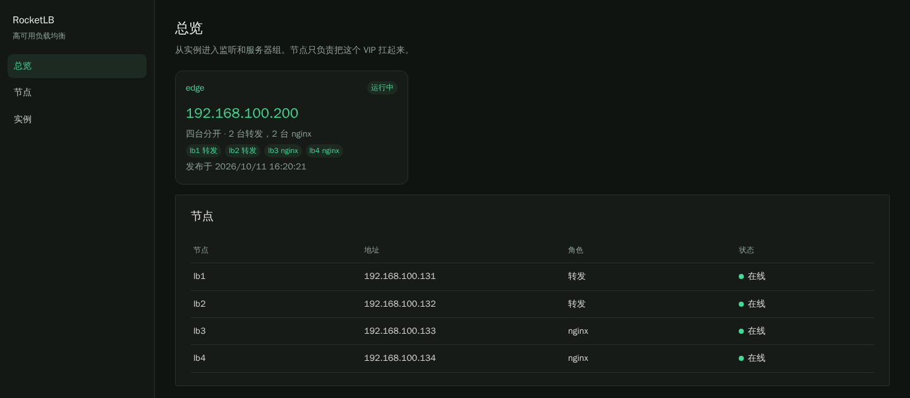
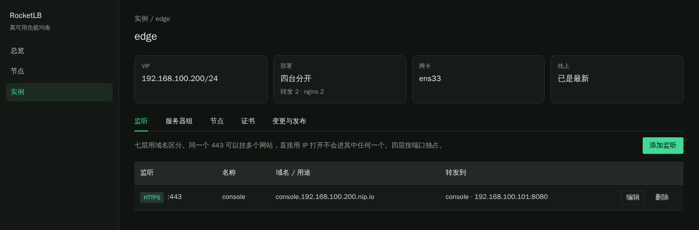
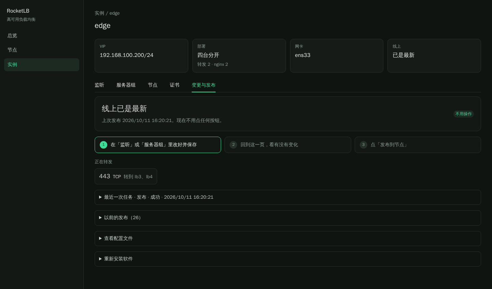
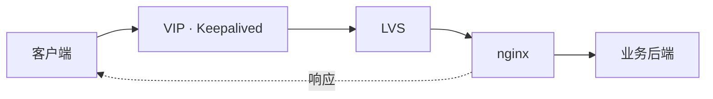

# RocketLB

机房高可用负载均衡的控制面。页面上配置监听和服务器组，RocketLB 渲染成 nginx 和 keepalived，再通过 SSH 安装到机器上并发布。

数据库里保存的是期望状态。节点上的配置文件是渲染结果。发布时先备份，再执行 `nginx -t` 和 `keepalived -t`，全部通过才写入并重新加载；有一台失败就把这次写入还原。

## 控制台

总览列出实例和节点。点进实例后配置监听，改完到「变更与发布」看状态。



七层用域名区分，同一个 443 可以挂多个网站，直接用 IP 打开不会进其中任何一个。四层按端口独占。



保存监听和服务器组只改控制面。这一页会说明线上是不是最新：已经是最新就不用点按钮；有改动时只出现「发布到节点」；还没装过软件时只出现「安装并发布」。



## 流量怎么走

客户端只访问 VIP。包按下面这条线走，响应从 nginx 直接回到客户端，不再经过 LVS。



LVS 不改目标 IP，只把二层网卡地址改成选中的 nginx。nginx 的回环上有一份 VIP/32，所以认这个地址。LVS 是内核 IPVS，ipvsadm 用来安装和清空规则。

| 层 | 谁在做 | 挂了以后 |
| --- | --- | --- |
| 入口 | Keepalived | 检查本机 LVS。LVS 不可用，或这台机器停了，VIP 交给另一台转发机器 |
| 分发 | 拿到 VIP 的那台上的 LVS | 按端口轮询。nginx 端口连不上，只把这台 nginx 从名单拿掉，VIP 不动 |
| 代理 | nginx | 七层走 HTTP，四层走 TCP 或 UDP。业务后端挂了，靠 nginx 自己的被动检查 |

可以两台一起，也可以四台分开。

| 部署 | 机器 | 平时谁拿 VIP |
| --- | --- | --- |
| 两台一起 | 每台都有 Keepalived、LVS 和 nginx | 优先级高的那台。本机 nginx 挂了，VIP 留在这台，新连接分给另一台 nginx |
| 四台分开 | 两台只做转发，两台只跑 nginx | 只在两台转发机器之间切换。nginx 挂了只影响分发名单 |

转发机器安装系统源的 Keepalived 和 ipvsadm。nginx 机器安装系统源的 nginx 和 libnginx-mod-stream。Ubuntu 20.04、22.04、24.04 用同一套安装命令，安装前把软件源换成阿里云镜像。20.04 和 22.04 的 nginx 是 1.18.0，24.04 是 1.24.0。

## 怎么配

1. 添加节点，探测在线。一台机器只能属于一个实例。
2. 创建实例，填写名称、VIP、网卡和成员。前缀、VRID、VRRP 密码由系统生成。发布之后不能再改节点、角色、VIP 或部署方式。
3. 添加服务器组和监听。
4. 第一次在「变更与发布」点「安装并发布」。之后改监听或服务器组，再回到这一页点「发布到节点」。

节点地址要是 IPv4，同一实例的网卡名要一致。开源 nginx 用 `max_fails` 做被动健康检查。

## 部署

一个镜像里同时有后端和前端，控制面本身不挂目录。集群、账号和 SSH 密码在 Postgres。登录密钥和数据加密密钥用环境变量。

数据库文件写在宿主机目录 `data/postgres`，不使用 Docker volume。这个目录已在 `.gitignore` 里。生产容器和开发脚本都会占用 8080，同一台机器上只跑其中一个。

```bash
docker compose up -d --build
docker compose stop
```

上线前用环境变量换掉 `ROCKETLB_JWT_SECRET`、`ROCKETLB_DATA_KEY`、数据库密码和管理员密码。`ROCKETLB_DATA_KEY` 是 32 字节的 base64。管理员默认 `admin` / `admin`，登录后可以在页面里改密码。`ROCKETLB_ADMIN_PASSWORD` 只在第一次创建管理员时生效。

## 开发

本机编译并后台运行控制面。Postgres 仍由 Compose 的 `postgres` 服务启动，数据同样在 `data/postgres`。可选的 `configs/dev.env` 会在启动时加载，不提交到仓库。

```bash
./scripts/service.sh start
./scripts/service.sh status
./scripts/service.sh stop
./scripts/service.sh restart
```

`make start`、`make stop`、`make restart`、`make status` 是同样的操作。日志在 `data/run/rocketlb.log`，控制台是 http://127.0.0.1:8080 。要热更新页面时另开终端：

```bash
cd web
npm install
npm run dev
```

打开 http://127.0.0.1:5173 。

```bash
go test ./...
```

测试使用临时 SQLite，不启动 Compose。
